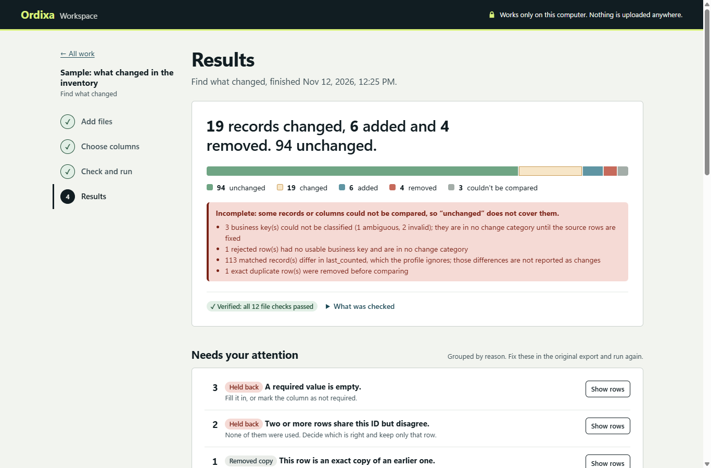
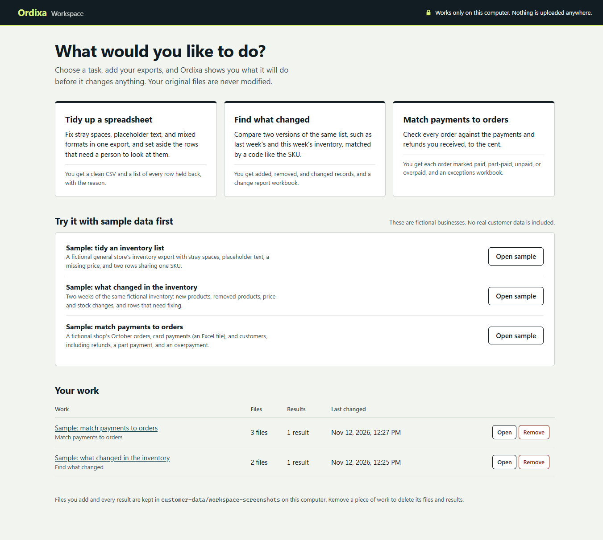
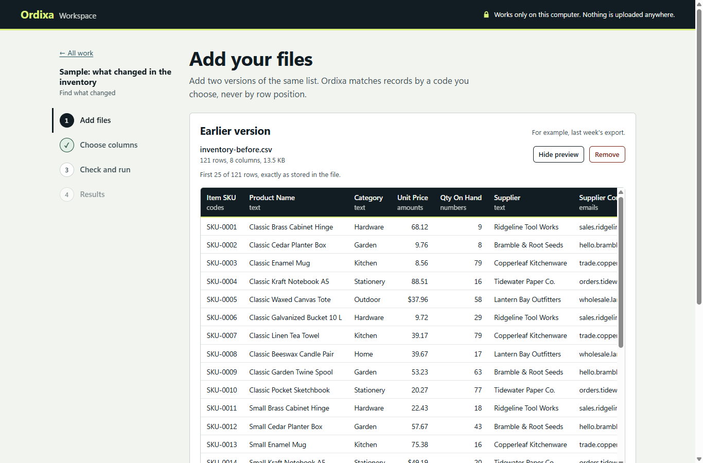
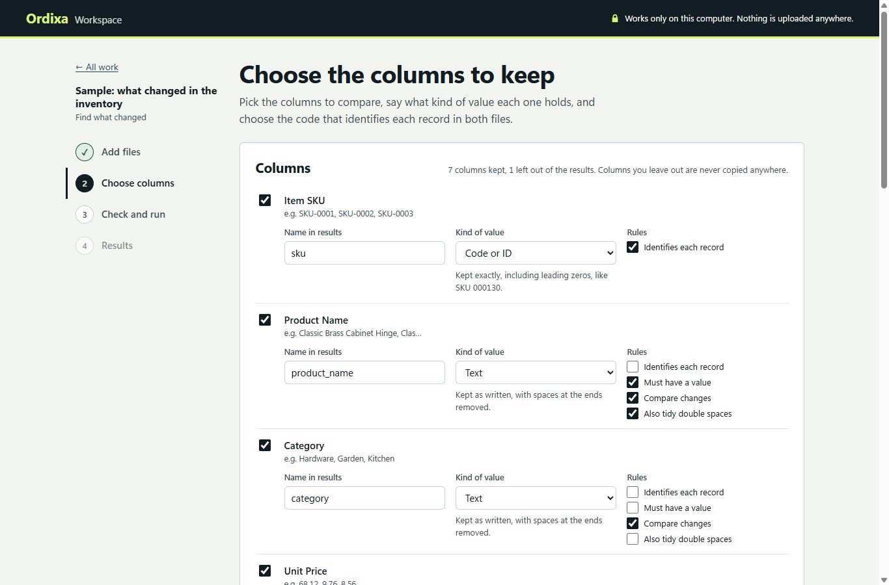
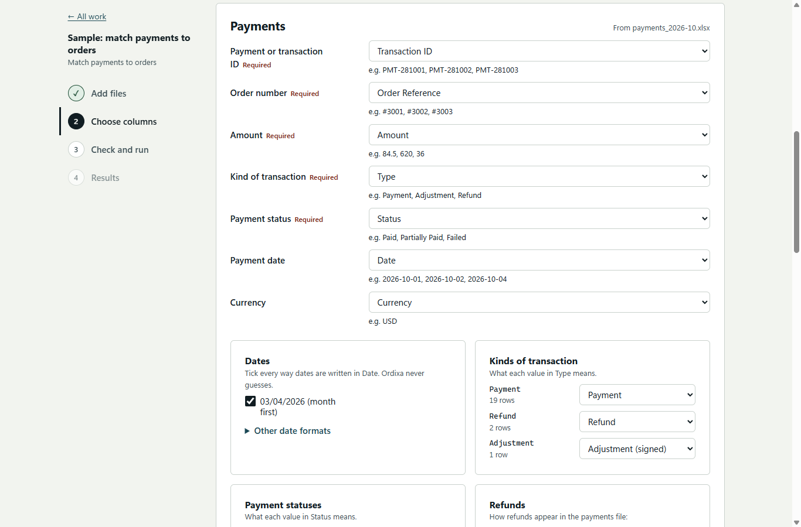
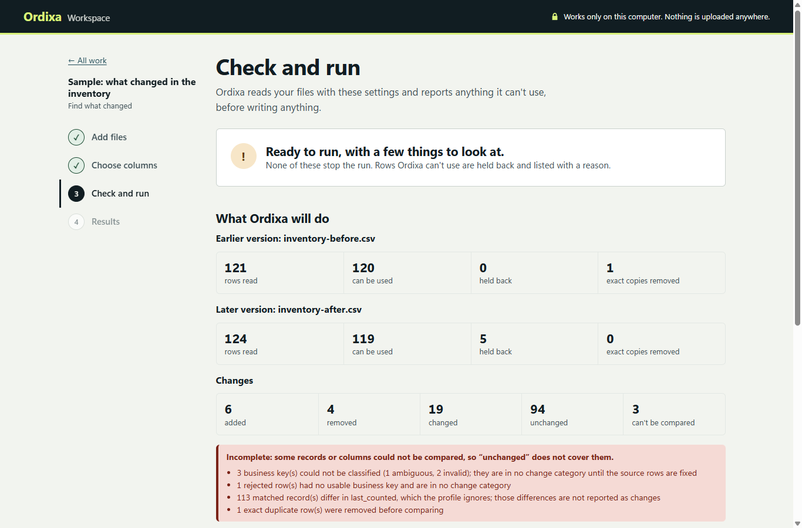
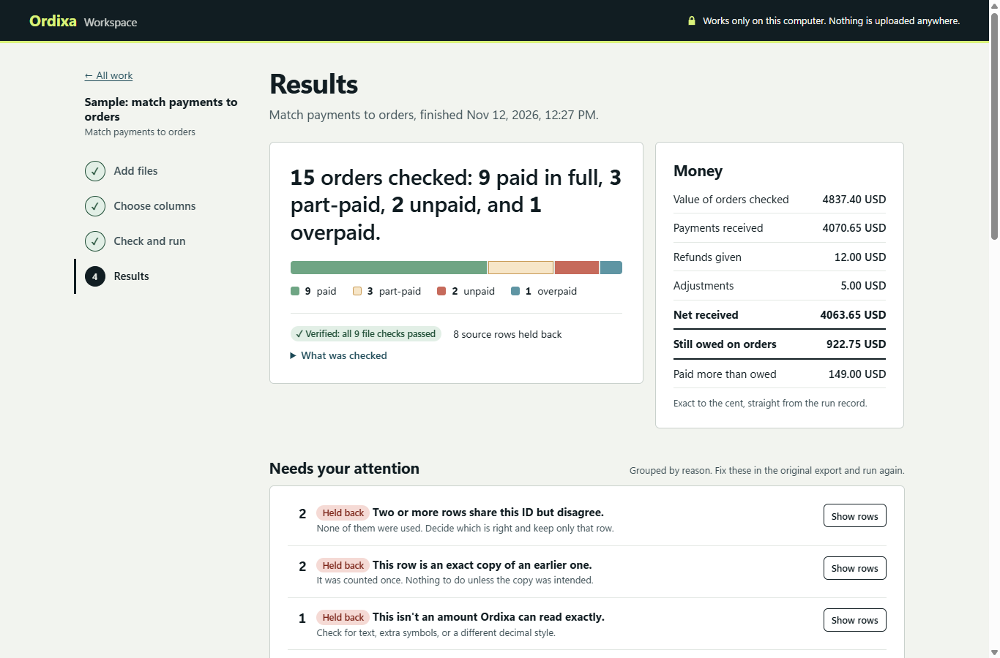
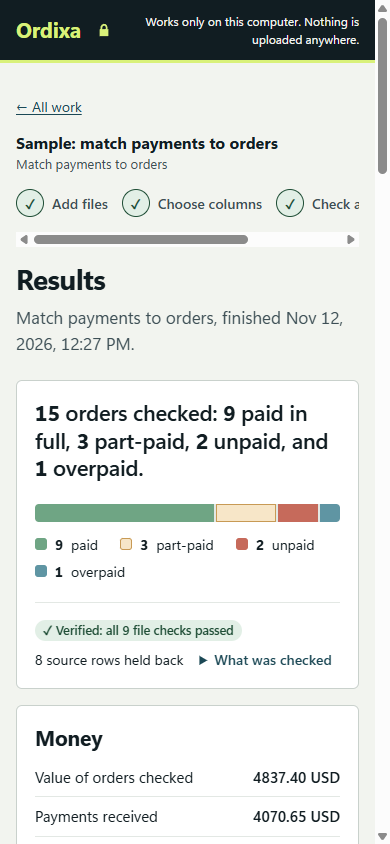

# The Ordixa workspace

The workspace is a page in your web browser for the three Ordixa tasks:
tidying up a spreadsheet (`clean`), finding what changed between two
versions (`compare`), and matching payments to orders (`run`). It is meant
for a business owner or bookkeeper who should not need a terminal, and for
demonstrating Ordixa on fictional data.

Everything still runs on your own computer. The workspace is a small web
server that listens only on `127.0.0.1`, needs no account, loads nothing
from the internet, and sends your files nowhere.

<p align="center">
  
</p>
<p align="center"><em>Results of the fictional inventory comparison in the workspace.</em></p>

## Start it

From a source checkout with the [Quick start](../README.md#quick-start)
prerequisites installed:

```bash
python -m app.ordixa workspace
```

Your browser opens `http://127.0.0.1:8765/`. Press Ctrl+C in the terminal
to stop it. Options:

| Option | Meaning |
| --- | --- |
| `--port 8800` | listen on another local port (1024 to 65535) |
| `--data-dir DIR` | keep files and results somewhere else (default `customer-data/workspace`, which git ignores) |
| `--no-browser` | do not open a browser window |

```bash
python -m app.ordixa workspace --port 8800 --no-browser
```

## A walkthrough

The home page offers the three tasks, three fictional samples to try first,
and a list of your earlier work. Every piece of work follows the same four
steps, shown down the left side.

<p align="center">
  
</p>

**1. Add files.** Choose or drop CSV and Excel (.xlsx) files. Each file is
copied into the workspace folder and only ever read; the original is not
touched. The workspace shows how many rows and columns it found, flags
problems straight away (an unreadable workbook, another text encoding, a
row with the wrong number of cells, several worksheets), and offers a
preview of the first 25 rows exactly as stored. Adding a second file with
identical contents is pointed out.

<p align="center">
  
</p>

**2. Choose columns.** The workspace suggests settings from the file's
columns: which to keep, what kind of value each holds (text, code or ID,
money, whole number, date), and which column identifies each record. It
never guesses whether `03/04/2026` is March or April; when both readings fit,
it asks. For reconciliation you match each piece of information (order
number, order total, payment amount, and so on) to a column, and say what
each payment status and transaction kind means, including which statuses
moved no money.

<p align="center">
  
</p>
<p align="center">
  
</p>

These settings are an ordinary Ordixa profile. *Download settings file*
saves it as TOML, *Load a settings file* reads one written by hand or saved
earlier, and every run keeps the exact profile it used, so the same work can
be repeated from the command line:

```bash
python -m app.ordixa compare --profile weekly-inventory.toml \
    --before last-week.csv --after this-week.csv --out output/compare
```

**3. Check and run.** Before anything is written, the workspace runs the
read-only preflight (the same one as `check-profile`) and says whether the
work is ready, ready with things to look at, or not ready yet, with each
problem in plain language and a link to where it is fixed. *Run* is only
available when nothing is blocking. A run can be stopped at any time.

<p align="center">
  
</p>

**4. Results.** A one-sentence summary and a bar show how the rows were
sorted. Below it: the verification badge, what needs attention grouped by
reason (with what happened and how to fix it), the data itself in pages,
and downloads. For reconciliation the money totals are shown exactly as the
run recorded them.

<p align="center">
  
</p>

The page also works on a narrow screen:

<p align="center">
  
</p>

## What the workspace reuses, and what it adds

The workspace does not clean, compare, reconcile, parse amounts, or write
results itself. It reuses the tested engine unchanged:

- **Runs are the command line.** *Run* starts `python -m app.ordixa clean`,
  `compare`, or `run` in a child process with the saved profile. The run
  directory, manifest, checksums, atomic publication (`.run-<id>.partial`
  renamed to `run-<id>` only when complete), workbook, and exit codes are
  exactly the CLI's. Tests compare the workspace's runs with the engine's
  and require identical result fingerprints and deterministic output
  checksums.
- **Settings are profiles.** The column screen edits a profile document.
  Before checking or running, it is written as TOML, read back, and
  validated by the engine's own profile loaders. A few common mistakes are
  explained in plain language first; anything else the engine reports is
  shown as is.
- **The check is the preflight.** `table_preflight` and `preflight` run in
  memory, read-only, exactly as `check-profile` runs them.
- **Verification is `verify`.** Each result page runs `verify_run` against
  the run directory and the input copies.
- **Downloads are the verified files.** Each download is re-checked against
  its manifest checksum first; a file changed since the run is refused
  rather than served. *Download everything* adds the manifest and the
  profile the run used.
- **Column descriptions come from `inspect`.** The suggested kinds of value
  use the `inspect` command's analysis; the workspace only turns them into
  pre-filled choices you confirm.

What it adds: file storage per piece of work, the suggestions, plain
explanations of every row reason the engine reports, the stop button, and
the page itself (plain HTML, CSS, and JavaScript served by FastAPI, with no
build step and no third-party code in the browser).

## Where files are kept

Each piece of work is one folder in the data directory:

```text
customer-data/workspace/sessions/<id>/
    session.json         the task, file list, and draft settings
    inputs/              copies of the files you added, never modified
    profiles/<sha>.toml  every profile a run used, named by its checksum
    runs/run-<id>/       run directories written by the Ordixa CLI
```

*Remove* on the home page deletes that folder: the copies of your files,
the settings, and every result. Your original files are not affected.
Treat the data directory like any other folder of customer exports and run
outputs; [DATA_HANDLING.md](DATA_HANDLING.md) applies to it unchanged.

## Privacy and security

- The server binds to `127.0.0.1` only. Other computers on the network
  cannot reach it.
- Requests must name the host the server was started on, which blocks DNS
  rebinding. API requests need the cookie the page sets (`HttpOnly`,
  `SameSite=Strict`), and anything that changes data also needs a token
  that is new on every start. Cross-site requests are refused.
- The page loads nothing from the internet, and its content security policy
  forbids scripts, styles, frames, and connections from anywhere else.
- Values from your files are always put on the page as text, never as HTML,
  so a cell containing markup or script is shown, not run. Spreadsheet
  formulas in your data are neutralized in every output, as in the CLI.
- File names are reduced to letters, digits, spaces, and `. _ ( ) + -`, and
  every path the API accepts is checked against what the session or the
  run's manifest lists, so no request can reach a file outside them.
- Files over 200 MB are refused while they are still arriving, and nothing
  of a refused or interrupted upload is kept.
- Run output shown on screen never includes `ORDIXA_DEBUG` details; the
  child process runs without that variable.

## When something goes wrong

| What happened | What the workspace does |
| --- | --- |
| A file is not CSV or .xlsx, is empty, or is over 200 MB | refuses it with the reason; nothing is kept |
| A file cannot be read (damaged workbook, another encoding) | keeps it listed with the reason and blocks the check until it is replaced |
| Settings are incomplete (no record key for a comparison, no date format, no currency) | explains each item and blocks the run |
| The preflight finds a blocking problem, such as a mapped card-number column | shows it and blocks the run |
| Rows are malformed, duplicated, or conflicting | runs anyway; every such row is held back and listed with its reason, never guessed |
| You press *Stop* | ends the child process and removes its unfinished staging folder; no result is published |
| A run takes over an hour | stops it the same way and says so |
| A run fails | shows what the CLI exit code means, what to do, and the CLI's own messages |
| The workspace or computer stopped mid-run | the unfinished `.run-<id>.partial` folder is listed as "not a result" with a button to remove it |
| A result file was changed after the run | the result shows failed checks and that file is no longer offered for download |

## Limitations

- **One person on one computer.** There are no accounts, no sharing, and no
  remote access by design. Two browser tabs on the same work are not
  coordinated beyond refusing a second run while one is in progress.
- **Same engine limits.** CSV and the first worksheet of an .xlsx file only,
  one currency per run, files up to 200 MB, exact matching only. See the
  [reconciliation](ORDIXA.md#known-limitations) and
  [spreadsheet](SPREADSHEET_WORKFLOWS.md#known-limitations) limitations.
- **Settings cover the common profile options.** Worksheet selection and
  optional source columns are kept when a profile file is loaded but cannot
  yet be edited on screen.
- **CSV files must be UTF-8.** A CSV in another encoding (such as an older
  Excel "CSV" in Windows-1252) is reported as unreadable. Re-save it as
  "CSV UTF-8", or use the command line with `input.csv_encoding`.
- **Large results are paged.** Tables show 100 rows at a time; the full
  files are always available to download.
- **Runs in progress are not remembered across a restart.** If the
  workspace stops while a run is in progress, the unfinished folder is
  reported afterwards, but the run must be started again.
